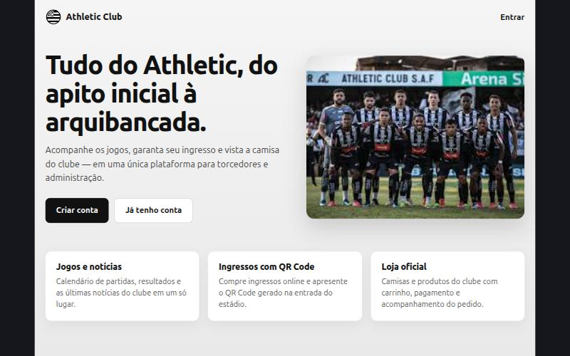

<div align="center">


# Athletic Club Platform

**The digital home of a football club — news, fixtures, QR-code tickets and an official store, with a full admin back office.**

[](https://github.com/BernardoFerrazG/ATHLETIC-SITE/actions/workflows/ci.yml)


</div>



## Overview

Small and mid-sized football clubs usually run their fan relationship across scattered channels: news on social media, tickets sold at the gate, merchandise through a third party. **Athletic Club Platform** puts all of it in one web app:

- **Fans** follow fixtures and news, buy match tickets (delivered as QR codes), shop for merchandise and track their orders.
- **Club staff** publish news and fixtures, manage the product catalogue and stock, move orders through fulfilment and read sales reports — all from a role-protected admin panel.

The project was built by a team of Computer Science students at **UFSJ** (Universidade Federal de São João del-Rei) for the Software Engineering course, following an agile workflow with user stories (`AP-*` tickets), feature branches and pull-request reviews. The UI is in Brazilian Portuguese.

## Features

| Area | Fans | Admins |
| --- | --- | --- |
| **Accounts** | Sign up, sign in, password reset by e-mail, editable profile | Role-based access (`torcedor` / `administrador`) |
| **Fixtures** | Match list with search, match details | Create, edit and delete fixtures |
| **News** | News feed with real-time search, article page | Publish articles with cover image |
| **Tickets** | Buy tickets per match; one QR code generated per seat | Ticket sales report |
| **Store** | Catalogue with filters, product page, persistent cart, checkout (PIX, credit/debit card, boleto) | Product CRUD with images and descriptions, stock control |
| **Orders** | Order tracking and unified purchase history | Orders grouped by customer, status workflow, sales report |

> Payments are simulated: checkout records the order and the chosen method in Firestore; no real payment gateway is called.

## Tech stack

- **Frontend:** React 19, TypeScript, React Router 7, Vite 8
- **Backend-as-a-Service:** Firebase Authentication and Cloud Firestore
- **Libraries:** `qrcode.react` (ticket QR codes), `react-icons`, `@emailjs/browser` (purchase confirmation e-mails)
- **Quality:** ESLint (typescript-eslint, React Hooks rules), strict TypeScript, GitHub Actions CI (lint + type-check + production build)

## Architecture

The code is organised **by feature** rather than by file type, so each business domain owns its pages, components, hooks, services and types:

```
src/
├── app/            # App shell and route table (lazy-loaded, guarded routes)
├── components/     # Shared UI (sidebar)
├── contexts/       # Global state: shopping cart (persisted in localStorage)
├── features/
│   ├── auth/       # Sign in/up, AuthContext, PrivateRoute & AdminRoute guards
│   ├── games/      # Fixtures
│   ├── home/       # Fan home and admin dashboard / sales reports
│   ├── ingressos/  # Match tickets
│   ├── loja/       # Store, cart, product admin
│   ├── news/       # News
│   ├── orders/     # Checkout, payments, order admin
│   └── users/      # Profile
├── lib/firebase.ts # Firebase initialisation (config from env vars)
└── pages/          # Public landing page
```

Key decisions:

- **Pages talk to Firestore through a service layer** (`features/*/services`) so UI components don't depend on query details.
- **Route guards** — `PrivateRoute` requires a signed-in user and `AdminRoute` additionally requires the `administrador` role, read from the user's Firestore profile.
- **Route-level code splitting** with `React.lazy`: each page is its own chunk, which keeps the initial bundle around 230 kB (≈75 kB gzipped).

More detail in [`docs/ARCHITECTURE.md`](docs/ARCHITECTURE.md).

## Getting started

### Prerequisites

- Node.js **20.19+** (22 LTS recommended)
- A Firebase project with **Authentication (e-mail/password)** and **Cloud Firestore** enabled

### Setup

```bash
git clone https://github.com/BernardoFerrazG/ATHLETIC-SITE.git
cd ATHLETIC-SITE
npm install
cp .env.example .env   # fill in your Firebase (and optionally EmailJS) keys
npm run dev
```

The app runs at `http://localhost:5173`.

To make a user an admin, set `role: "administrador"` on their document in the `users` collection.

### Scripts

| Command | Description |
| --- | --- |
| `npm run dev` | Start the dev server with hot reload |
| `npm run build` | Type-check and build for production into `dist/` |
| `npm run preview` | Serve the production build locally |
| `npm run lint` | Run ESLint |
| `npm run typecheck` | Run the TypeScript compiler without emitting |

### Data model (Firestore)

| Collection | Contents |
| --- | --- |
| `users` | Profile and role of each account (document id = Firebase Auth uid) |
| `games` | Fixtures: title, opponent, date/time, venue (also listed as ticketed events) |
| `news` | Articles: title, content, cover image, author, publish date |
| `products` | Store items: name, description, images, price, stock |
| `orders` | Store orders: items, total, payment method, status |
| `ingressos_comprados` | Purchased tickets: match, quantity, total, buyer |

## Roadmap

- Firestore security rules mirroring the client-side role checks
- Real payment gateway integration (PIX / card)
- Ticket validation flow at the stadium gate (QR scanner for staff)
- Automated tests (Vitest + React Testing Library) for services and route guards

## Team

Built at UFSJ by:

- [Bernardo Ferraz](https://github.com/BernardoFerrazG)
- [isanunes12](https://github.com/isanunes12)
- João Gabriel
- João Pedro Cardoso
- [João Pedro Tozetto da Cunha](https://github.com/joaopedrotozettodacunha)

Original repository: [ufsj-dcomp/site-atlhetic](https://github.com/ufsj-dcomp/site-atlhetic).
